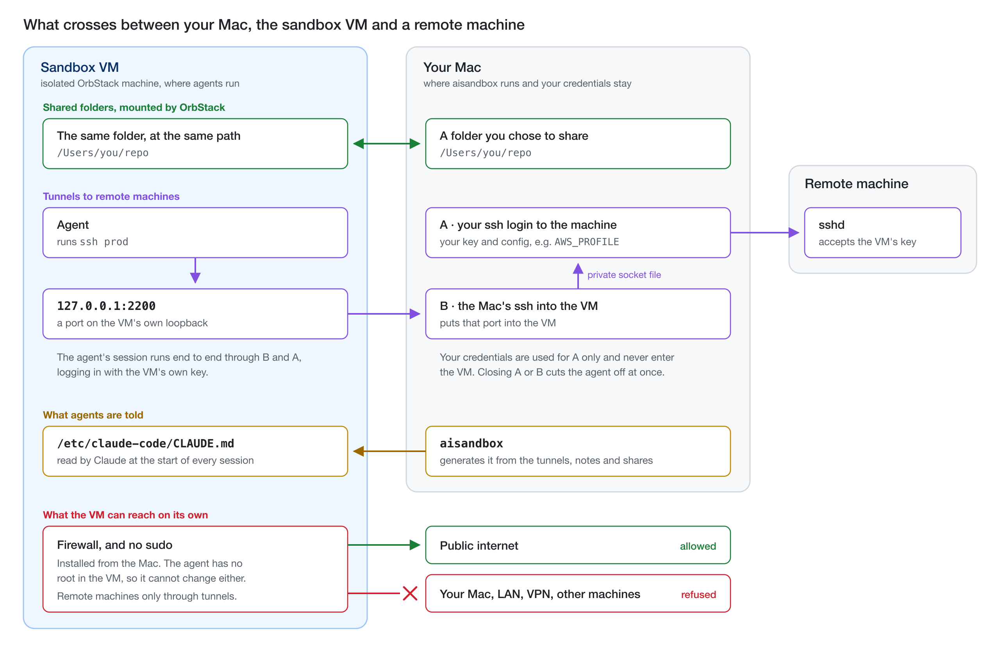

# aisandbox

Turns an [OrbStack](https://orbstack.dev) Linux machine on a Mac into a
sandbox for AI coding agents. It starts the machine, hardens it, shares the
folders you choose with it, and opens SSH tunnels to the remote machines you
choose.

The sandbox can reach **itself and the public internet, nothing else**: not
your Mac, not your LAN or VPN. Remote machines are reachable only through
tunnels that you open from the Mac, and your credentials stay there.



## What this is, and is not

It narrows what an agent can reach, and makes the access that remains
explicit and switchable from the Mac. It is **not a hard security boundary**:

- An OrbStack isolated machine shares its kernel with OrbStack's other
  machines, and OrbStack itself calls it "not a full security boundary". An
  agent that gains root in the VM can remove the firewall.
- Shared folders are read-write, so an agent can leave files there (git
  hooks, build scripts) that later run on your Mac.
- The agent has unrestricted access to the public internet.

[Limits](#limits) has the full list. Use it to keep an honest agent, or a
confused one, inside the lines; do not rely on it against a determined one.

It was built for one setup and is published as it is: Claude Code running in
the VM as a remote environment of Claude desktop. It was developed and tested
with **OrbStack 2.2.5 on macOS 27 (Apple silicon) and an Ubuntu 26.04
machine**. Parts of it exist to work around OrbStack behaviour seen in that
version; those are marked below and may no longer apply in another.

## Requirements

- macOS with OrbStack 2.x (it needs OrbStack's *isolated machines*).
- An Ubuntu machine in OrbStack. Provisioning uses `apt` and `systemd`; other
  Debian-like distributions may work and were not tried.
- Nothing to install on the Mac: the tool is one zsh script and uses `ssh`
  and `nc` as macOS ships them. The tests additionally use `expect` for one
  section.

## Getting started

1. Create an isolated machine. The tool expects the name `AIsandbox`; for
   another name set `AISANDBOX_MACHINE` in your shell.

   ```bash
   orb create --isolated --isolate-network ubuntu AIsandbox
   ```

2. Get the tool and put it on your `PATH`:

   ```bash
   git clone https://github.com/tbenr/aisandbox.git
   ln -s "$PWD/aisandbox/aisandbox" "$(brew --prefix)/bin/aisandbox"   # or any directory on your PATH
   ```

3. Set the sandbox up, then check it:

   ```bash
   aisandbox up
   aisandbox doctor
   ```

   The first `up` installs three packages in the VM (`nftables`,
   `openssh-server`, `git`), takes away the agent user's sudo, loads the
   firewall and restarts the VM once. It takes well under a minute. `doctor`
   then verifies the isolation from inside the VM.

4. Share the folders agents should work in. A change to the shared folders
   needs a VM restart:

   ```bash
   aisandbox mount add ~/code/my-repo
   aisandbox down && aisandbox up
   ```

5. Point Claude desktop at the sandbox: see
   [Connecting Claude desktop](#connecting-claude-desktop).

6. If agents need a remote machine, give them a tunnel: see
   [Giving agents access to a remote machine](#giving-agents-access-to-a-remote-machine).

The tool keeps its own state (the tunnel list, a key for reaching the VM,
ssh control sockets) in `~/.aisandbox`. `AISANDBOX_HOME` moves it; keep that
path short, because the sockets' paths are limited to about 100 characters.

## Daily use

```bash
aisandbox            # menu
aisandbox up         # start the VM, enforce isolation and hardening, open tunnels
aisandbox status
aisandbox doctor     # prove the isolation from inside the VM
aisandbox down       # close tunnels, stop the VM
```

The first `up` sets the sandbox up; every later one checks it and repairs what
drifted. It is safe to repeat.

`up` either ends with a hardened VM or with a stopped one:

- It corrects the OrbStack isolation settings and restarts the VM if any had
  drifted.
- If the hardening cannot be applied, it stops the VM and exits non-zero.
- If the VM was found running without its firewall or with agent sudo, it is
  hardened and then restarted once, so nothing started in that state survives.

Exit status is non-zero when hardening failed, an autostart tunnel did not
open (`up`), or a check failed (`doctor`).

### Giving agents access to a remote machine

```bash
aisandbox tunnel add prod my-server     # my-server: whatever you type after `ssh` on the Mac
aisandbox key                           # add this line to ~/.ssh/authorized_keys on the target
```

Agents in the VM then use `ssh prod`. Close it with `aisandbox tunnel down prod`;
access stops immediately.

If your own login needs a key file or an environment variable, store them with
the tunnel. For example, if you normally connect with
`AWS_PROFILE=dev ssh -i ~/.ssh/key ec2-user@i-0abc`:

```bash
aisandbox tunnel add box ec2-user@i-0abc -i ~/.ssh/key --env AWS_PROFILE=dev
```

Both are used only on the Mac, for connection A below, and are applied again
every time the tunnel is reopened. Neither the key nor the variable reaches
the VM. `--env` can be repeated; a value cannot contain spaces, `,` or `|`.

### How agents learn about the tunnels

Two things in the VM, both generated from the tunnel list and both root-owned
(agents can read them, not change them):

- **`/etc/claude-code/CLAUDE.md`**, Claude Code's location for machine-wide
  instructions, loaded at the start of every session. It lists the tunnels by
  name with your note, and explains the sandbox: private networks blocked, no
  sudo, unsigned commits, no pushing. It is rewritten whenever tunnels, notes
  or shared folders change; a running session keeps the version it started with.
- **`sandbox-tunnels`**, a command that lists the tunnels with their live
  state (`open` / `closed`). It works for any tool, and mid-session.

Give each tunnel a note so an agent knows what it is looking at:

```bash
aisandbox tunnel note prod "production replica, read-only queries only"
```

The VM is told only a tunnel's name, login user and note. The real address of
the target and the way the Mac logs in to it never reach the VM.

| Command | |
|---|---|
| `tunnel add <name> <ssh-target> [--note TEXT] [-i KEYFILE] [--env NAME=VALUE]... [--user U] [--port N] [--remote-port 22] [--no-auto]` | register and open |
| `tunnel note <name> [text]` | set the note agents see; no text clears it |
| `tunnel add <name> --direct host:port [--user U]` | target reachable from the Mac without an ssh login |
| `tunnel ls`, `tunnel up [name]`, `tunnel down [name]`, `tunnel rm <name>` | |

Tunnels marked `auto` (the default) are reopened by `aisandbox up`. A dropped
tunnel is not reconnected automatically: `status` shows it, `tunnel up` restores it.

### Other

```bash
aisandbox mount ls | add <folder> | rm <folder>   # shared folders; a change needs a VM restart
aisandbox root -- apt-get install -y jq           # the agent user has no sudo; install from here
aisandbox shell                                   # shell as the agent user
```

### Git in the VM

`up` installs git and sets it up so agents can commit in the shared
repositories:

- Commits and tags made in the VM are **unsigned**, even where the repository
  says `commit.gpgsign=true`. The signing key stays on the Mac. This is done
  with git's environment-variable configuration in `/etc/profile.d`, so the
  shared `.git/config` is not touched and the Mac keeps signing.
- The author identity is copied from the Mac's global git config.
- The VM has no GitHub credential. An agent's branch is already on the Mac,
  because the repository is shared; push it from there. To sign the commits
  first: `git rebase --force-rebase --gpg-sign <base-branch>`.

### Shared folders and git worktrees

A shared folder is at **the same path in the VM as on the Mac**
(`/Users/you/repo`). OrbStack mounts it there itself: `aisandbox mount add`
registers the folder that way, and `up` moves a share that is still at
OrbStack's default location (`/mnt/mac/<path on the Mac>`), restarting the VM
once for it.

The reason is git worktrees. A worktree stores absolute paths, and git stores
the physical path it is working from. With the folder at the same path on
both sides, worktrees created on the Mac inside a shared folder work in the
VM as they are, and worktrees created in the VM work on the Mac.

A folder is only put at its Mac path where that is safe
([vm/sharecheck.sh](vm/sharecheck.sh)): every directory above the path must be
changeable by root alone, and nothing may be in the way. Otherwise an agent
could leave a symlink on the way and have the next start mount the folder
somewhere else. A share whose Mac path falls under a directory the agent can
write to in the VM (`/tmp/...`, for instance) therefore stays at
`/mnt/mac/...`; `up` says why, and `doctor` reports it as skipped.

`up`, `doctor` and the instructions agents get all ask the VM the same
question: is OrbStack's mount of that very Mac folder at its path right now?
A directory merely existing there does not count. If a mount is missing, `up`
exits non-zero, `doctor` fails, and the folder is not mentioned to agents.

**Worktrees elsewhere on the Mac** (not shared) cannot be used from the VM
and show as "prunable" in `git worktree list` there. They are not missing.
Two guards keep the VM from deleting their metadata on the Mac:
`gc.worktreePruneExpire=never`, so that an automatic `git gc` does not prune
them, and a small `git` wrapper in `/usr/local/bin` that refuses
`git worktree prune`. The wrapper stops accidents; it is not a barrier
(`/usr/bin/git` is still there).

## Connecting Claude desktop

Use `<machine>@orb` as the SSH host of the remote environment, so
`AIsandbox@orb` with the default name. That is OrbStack's own SSH, set up by
the line
`Include ~/.orbstack/ssh/config` that OrbStack adds to `~/.ssh/config`;
`doctor` checks that it works. Open projects at their Mac path
(`/Users/you/repo`).

Do not use the machine's `<machine>.orb.local` name for this. With OrbStack
2.2.5 it worked for a while, then OrbStack stopped publishing the name for the
machine, and restarting the VM and OrbStack did not bring it back. The cause
was not found.

## How a tunnel works

Three SSH connections. A and B are opened from the Mac; C is the agent's own
session travelling through them.

| | From → to | Purpose |
|---|---|---|
| A | Mac → target | Your normal login. Re-opens the target's SSH port as a private socket file in `~/.aisandbox/run/` on the Mac. |
| B | Mac → VM | Delivers that socket into the VM as a port on the VM's loopback (2200, 2201, …). |
| C | agent → target | `ssh <name>` in the VM connects to that port and logs in with the VM's own key. |

- Your Mac credentials are used for A only and never enter the VM.
- The socket file exists only on the Mac. The VM sees a listening port, nothing else.
- B goes to a small SSH server inside the VM (`127.0.0.1:2222`, one account,
  one key held on the Mac) over OrbStack's own channel. It exists because
  OrbStack's built-in SSH refuses reverse forwards into isolated machines
  (seen with OrbStack 2.2.5).

## What enforces the sandbox

| Layer | Where | Blocks |
|---|---|---|
| OrbStack `isolated` + `isolate_network` | outside the VM | Mac filesystem except the mounts, OrbStack's host addresses, other machines |
| `nftables` egress rules ([vm/nftables.conf](vm/nftables.conf)) | inside the VM | the Mac's LAN address, the LAN, VPN and all other private ranges |
| No sudo for the agent user | inside the VM | changing the firewall or the tunnel SSH server |
| `machines.expose_ports_to_lan = false` | OrbStack | VM services being published on your LAN |

With OrbStack 2.2.5, its network isolation alone leaves the Mac's LAN address and the rest of
the LAN reachable, which is why the firewall exists.

Nothing on the Mac enforces the firewall: all VM traffic leaves as the OrbStack
process, so macOS cannot filter one VM. Instead the rules are installed as root
**from the Mac** (`orb -u root`), a path that does not exist inside the VM.
They load at boot, so the VM is hardened even when something other than
`aisandbox up` starts it.

The firewall filters by destination. The one exception is the answering side
of connections opened from outside (the Mac reaching a dev server in the VM);
a connection the VM opened itself is never exempt, however old it is.

## Files

- `aisandbox` — the CLI (zsh, no dependencies)
- `vm/provision.sh` — runs as root in the VM on every `up`
- `vm/nftables.conf` — the firewall rules; edit here, then `aisandbox up`
- `vm/sharecheck.sh` — decides whether a shared folder may be mounted at its Mac path in the VM
- `vm/agent-instructions.md` — the text agents get, as a template
- `test/` — the test suites; see [test/README.md](test/README.md)
- `docs/overview.svg` — the diagram above; after editing it, render the PNG
  with `rsvg-convert -z 2 -o docs/overview.png docs/overview.svg`
- `~/.aisandbox/` — tunnel list, the Mac→VM tunnel key, sockets (not in this folder on purpose)

## Tests

```bash
test/run
```

runs the suites that change nothing of yours: an offline one for the CLI, and
two that work on disposable paths and throwaway repositories in the VM.
`test/run all` adds an end-to-end tunnel test and one that makes single calls
to the VM fail. A further suite restarts the VM and has to be asked for
explicitly. [test/README.md](test/README.md) says what each one needs and
touches.

## Limits

- OrbStack says isolated machines share one kernel and are "not a full security
  boundary". An agent that gets root through a kernel or privilege-escalation
  exploit can remove the firewall.
- Shared folders are read-write: an agent can plant files (git hooks, build
  scripts) that later run on the Mac.
- DNS is answered by the Mac's resolver, so internal names resolve even though
  their addresses are blocked.
- A target whose SSH port is on the public internet can be reached directly as
  well as through a tunnel. Tunnels are the only way in for hosts behind your
  LAN, VPN or a bastion.
- The VM's key is not a secret from the agent, which has internet access and
  could copy it out. What limits its use is that the target is reachable only
  through your tunnel. Do not authorize it on a host with a public SSH port.
- On a target, the agent is that account: it can do whatever the account can,
  including connecting onwards. Use a dedicated account where that matters.
- VM loopback ports, including tunnel ports, are mirrored by OrbStack onto the
  Mac's `127.0.0.1`.

## License

MIT. See [LICENSE](LICENSE).
